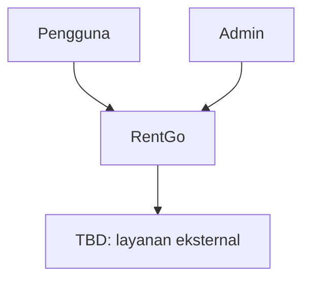
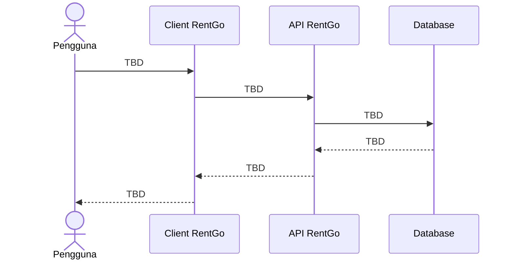

# System Architecture: RentGo

## Metadata

- **Status:** Draft
- **Owner:** Tim RentGo
- **Last Updated:** 2026-11-10
- **Version:** 0.1.0
- **Related PRD:** [PRD](../prd/PRD.md)

## 1. Architecture Summary

> Jelaskan bentuk sistem, batas utama, dan alasan pemilihan arsitektur dalam 3-5 kalimat.

## 2. Architecture Principles

- Pisahkan tanggung jawab antar layer dan modul.
- Validasi input di boundary sistem.
- Simpan keputusan penting sebagai ADR.
- Utamakan solusi paling sederhana yang memenuhi kebutuhan PRD.
- Jangan menambahkan dependensi tanpa alasan dan dampak yang terdokumentasi.

## 3. System Context

### External Systems

| Sistem | Tujuan | Arah integrasi | Status |
|---|---|---|---|
| TBD | TBD | TBD | Belum diputuskan |

## 4. Container / Major Components

| Komponen | Tanggung jawab | Teknologi | Status |
|---|---|---|---|
| Client | TBD | TBD | Direncanakan |
| Application/API | TBD | TBD | Direncanakan |
| Database | TBD | TBD | Direncanakan |

## 5. Component Boundaries

> Isi modul utama dan aturan komunikasi antar modul.

- **Identity/Auth:** TBD
- **Vehicle Catalog:** TBD
- **Booking/Rental:** TBD
- **Payment:** TBD
- **Notification:** TBD
- **Administration:** TBD

## 6. Main Flow

## 7. Data Model

### Core Entities

| Entity | Purpose | Key fields |
|---|---|---|
| User | TBD | TBD |
| Vehicle | TBD | TBD |
| Booking | TBD | TBD |
| Payment | TBD | TBD |

### Data Rules

- Ownership and access rules: TBD
- Retention and deletion: TBD
- Audit requirements: TBD

## 8. API and Contracts

- API style: TBD
- Authentication: TBD
- Error format: TBD
- Versioning: TBD
- Pagination/filtering: TBD

## 9. Security

- Authentication and authorization: TBD
- Password and secret management: TBD
- Input validation: TBD
- Sensitive data handling: TBD
- Logging and audit: TBD

## 10. Deployment and Operations

- Runtime environment: TBD
- Environments: Development, staging, production
- Configuration management: TBD
- Backup and restore: TBD
- Monitoring and alerting: TBD

## 11. Architecture Decision Records

| ID | Decision | Status | Link |
|---|---|---|---|
| ADR-001 | TBD | Proposed | TBD |

## 12. Open Questions and Risks

- [ ] Teknologi utama apa yang digunakan?
- [ ] Apakah sistem membutuhkan real-time availability?
- [ ] Bagaimana konflik booking ditangani?
- [ ] Apa kebutuhan privasi dan regulasi data?
- [ ] Bagaimana sistem menangani kegagalan layanan eksternal?

## 13. Changelog

| Tanggal | Perubahan | Penulis |
|---|---|---|
| 2026-11-10 | Membuat draft awal arsitektur | Tim RentGo |
