# ARCHITECTURE — RentGo

> Dokumen arsitektur sistem RentGo: **bagaimana** bagian-bagian aplikasi disusun, saling bergantung, dan berjalan.
> Turunan dari `PRD.md` (spesifikasi, kontrak method, aturan bisnis). Bila ada konflik, **`PRD.md` yang benar**; perbaiki dokumen ini lewat PR.
> Kode, nama file, dan nama tabel/kolom memakai bahasa Inggris; teks yang tampil ke pengguna Bahasa Indonesia.

| Item | Nilai |
|---|---|
| Gaya arsitektur | Aplikasi desktop monolit, **MVC + DAO** berlapis |
| Platform | Java 21 (kode dibatasi fitur ≤ Java 17), Swing + FlatLaf 3.8 |
| Penyimpanan | PostgreSQL di Neon (bersama tim) via pgjdbc 42.7.14 |
| Proses | Satu proses JVM per pengguna; tidak ada server aplikasi |
| Root package | `rentgo` |

---

## 1. Gambaran Sistem (Konteks)

RentGo berjalan di komputer petugas. Tidak ada server aplikasi di tengah: setiap instans aplikasi berbicara **langsung** ke database PostgreSQL di Neon melalui JDBC. Banyak instans (satu per anggota tim / petugas) berbagi data yang sama karena berbagi satu database.

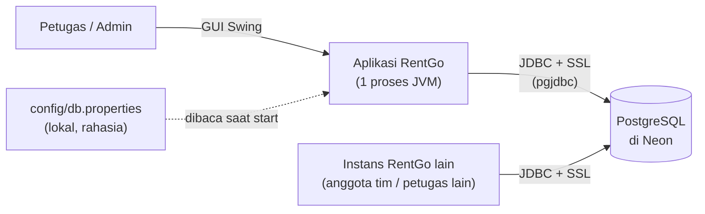

Konsekuensi arsitektural:
- **Tidak ada state bersama di memori antar-instans.** Kebenaran data ada di database; aplikasi tidak boleh meng-*cache* status kendaraan untuk keputusan bisnis (cek ketersediaan selalu dibaca ulang di dalam transaksi, §7).
- **Kredensial database ada di mesin klien** (`config/db.properties`). Ini kompromi yang disadari untuk skala tugas kuliah (lihat §11).
- Aplikasi harus **tahan terhadap database tidak terjangkau** (internet putus, Neon *cold start*): gagal dengan pesan jelas, bukan crash.

---

## 2. Arsitektur Berlapis

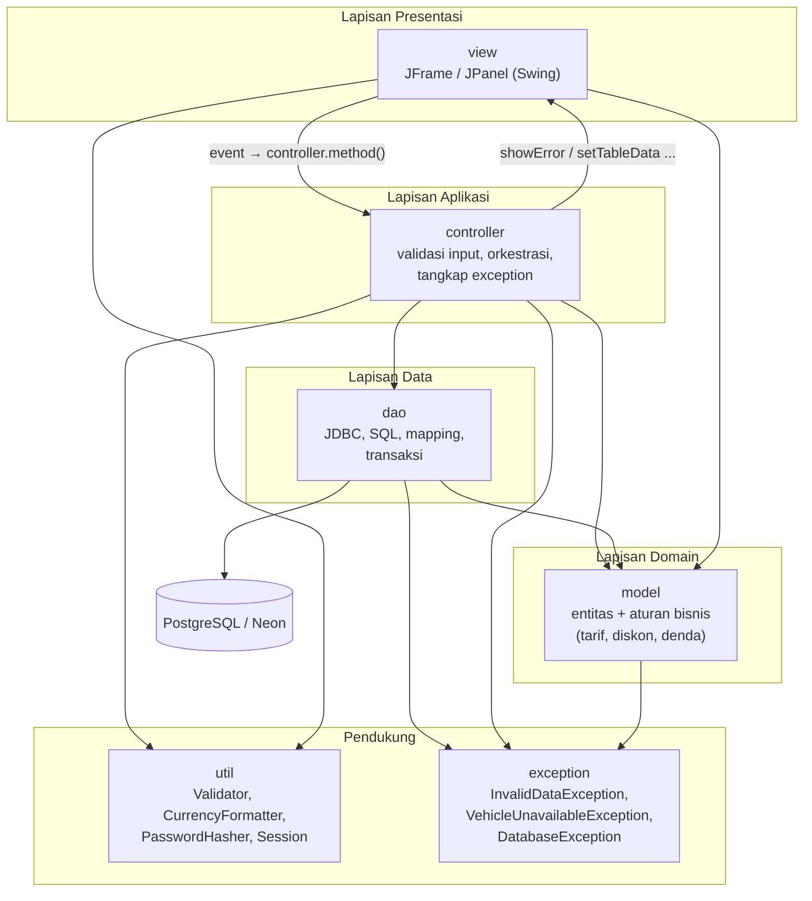

### 2.1 Tanggung jawab per lapisan

| Lapisan | Paket | Tanggung jawab utama | Tidak boleh |
|---|---|---|---|
| Presentasi | `view` | Membangun komponen Swing & layout, memasang listener, menampilkan data/dialog, membatasi tombol/menu sesuai peran | SQL, aturan bisnis, memanggil DAO |
| Aplikasi | `controller` | Menerima aksi dari view, **mengonversi** teks → angka/tanggal, memvalidasi (`Validator`), memanggil model & DAO, menerjemahkan exception menjadi pesan | SQL, membuat komponen Swing baru, aturan tarif |
| Domain | `model` | Entitas, invarian lewat setter, **semua aturan hitung** (sewa, diskon, sopir, denda), teks struk | `javax.swing`, `java.sql`, akses DB |
| Data | `dao` | Koneksi, SQL (`PreparedStatement`), mapping `ResultSet` ↔ objek, **batas transaksi**, menerjemahkan `SQLException` | Dialog, aturan bisnis, `javax.swing` |
| Pendukung | `util`, `exception` | Fungsi lintas lapisan yang tidak punya state bisnis; hierarki exception | Bergantung pada `controller`/`view`/`dao` |

### 2.2 Aturan dependensi antar-paket

| Paket | Boleh bergantung pada |
|---|---|
| `model` | `exception` |
| `util` | `exception`, `model` (`Session` menyimpan `Staff`) |
| `dao` | `model`, `exception`, `util` |
| `controller` | `dao`, `model`, `util`, `exception`, **API publik panel di `view`** |
| `view` | `controller` (hanya memanggil method publik), `model`, `util` |
| `Main` | semua (titik rakit aplikasi) |

Yang **dilarang**: `model → dao/view/controller`; `dao → controller/view`; `view → dao`.

> **Catatan jujur tentang siklus.** `view` memegang referensi ke `controller` (untuk memanggil aksi), dan `controller` memegang referensi ke panel `view` (untuk memperbarui tampilan). Jadi ada ketergantungan dua arah antara paket `view` dan `controller`. Ini pilihan sadar dari PRD §5 (pola MVC sederhana yang sesuai materi kuliah). Kendalinya: `controller` hanya memakai method publik *standar* panel (`showError`, `showInfo`, `confirm`, `setTableData`, getter field) dan **tidak pernah** menyentuh komponen Swing mentah; `view` hanya memanggil method publik controller dan tidak memuat logika. Bila kelak ingin memutus siklus, ganti tipe parameter konstruktor controller dengan interface view (mis. `VehicleView`) tanpa mengubah perilaku.

---

## 3. Komponen & Tanggung Jawab

### 3.1 Peta komponen

| Fitur (modul) | View | Controller | DAO | Model utama |
|---|---|---|---|---|
| Autentikasi | `LoginFrame`, `MainFrame` | `LoginController` | `StaffDAO` | `Staff`, `Role` |
| Kendaraan | `VehiclePanel` | `VehicleController` | `VehicleDAO` | `Vehicle`, `Car`, `Motorcycle`, `Bus`, `VehicleType`, `VehicleStatus` |
| Pelanggan | `CustomerPanel` | `CustomerController` | `CustomerDAO` | `Customer`, `Person` |
| Penyewaan | `RentalPanel` | `RentalController` | `RentalDAO`, `PaymentDAO` | `Rental`, `Payment`, `RentalStatus`, `PaymentMethod` |
| Pengembalian | `VehicleReturnPanel` | `VehicleReturnController` | `VehicleReturnDAO` | `VehicleReturn`, `VehicleCondition` |
| Laporan (P1) | `ReportPanel` | `ReportController` | `ReportDAO` | — (hasil berupa `Object[]`) |
| Pengguna (P2) | `UserManagementPanel` | `UserManagementController` | `StaffDAO` | `Staff`, `Role` |

### 3.2 Model domain

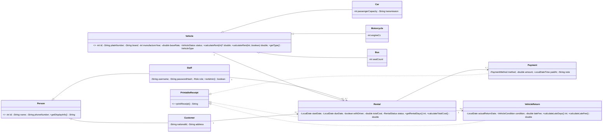

**Titik polimorfisme kunci:** `Rental.calculateTotalCost()` memanggil `vehicle.calculateRent(getRentalDays(), withDriver)` lewat referensi `Vehicle`. Rental, controller, dan view **tidak pernah** menanyakan jenis kendaraan untuk menghitung biaya. Menambah jenis kendaraan baru = menambah subclass + satu nilai enum + satu cabang di *factory method* `VehicleDAO` (lihat §10).

### 3.3 Pola desain yang dipakai

| Pola | Tempat | Alasan |
|---|---|---|
| MVC | `view` / `controller` / `model` | Pemisahan tampilan, orkestrasi, dan domain (syarat tugas) |
| DAO | `dao` | Mengisolasi SQL; media penyimpanan dapat diganti tanpa menyentuh model/view |
| Singleton | `DatabaseConnection` | Satu titik konfigurasi dan pengelolaan koneksi |
| Template/Polimorfisme | `Vehicle.calculateRent` | Aturan tarif berbeda per jenis |
| Factory method (privat) | `VehicleDAO` (baris → `Car`/`Motorcycle`/`Bus`) | Memusatkan pemetaan `vehicle_type` ke subclass |
| Generics | `CrudDAO<T>` | Kontrak CRUD seragam, memenuhi kriteria generics |
| Observer (event) | `ActionListener` Swing | Penanganan event tombol |

---

## 4. Struktur Paket & Kode

```
rentgo
├── Main                      titik masuk & perakitan awal
├── model/                    Person, Customer, Staff, Vehicle, Car, Motorcycle, Bus,
│                             Rental, Payment, VehicleReturn, PrintableReceipt, 6 enum
├── exception/                InvalidDataException, VehicleUnavailableException, DatabaseException
├── dao/                      DatabaseConnection, CrudDAO<T>, Vehicle/Customer/Staff/Rental/
│                             Payment/VehicleReturn/Report DAO
├── controller/               Login/Vehicle/Customer/Rental/VehicleReturn/Report/UserManagement
├── view/                     LoginFrame, MainFrame, Vehicle/Customer/Rental/VehicleReturn/
│                             Report/UserManagement Panel
└── util/                     Validator, CurrencyFormatter, PasswordHasher, Session
```
Daftar file lengkap dan kepemilikan per anggota: `PRD.md` §4 dan §14.1.

---

## 5. Alur Runtime

### 5.1 Start aplikasi

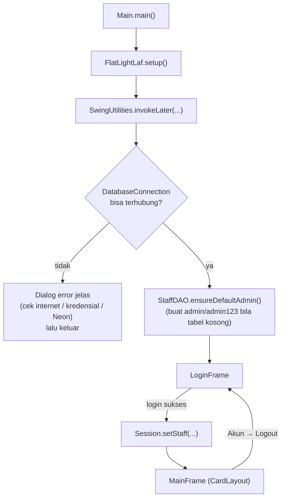

### 5.2 Rakitan MVC (wiring)

`MainFrame` merakit setiap modul: panel dibuat, controller dibuat dengan panel + DAO, lalu `panel.setController(controller)`. Controller tidak memasang listener sendiri; listener ada di panel dan memanggil `controller.method()`.

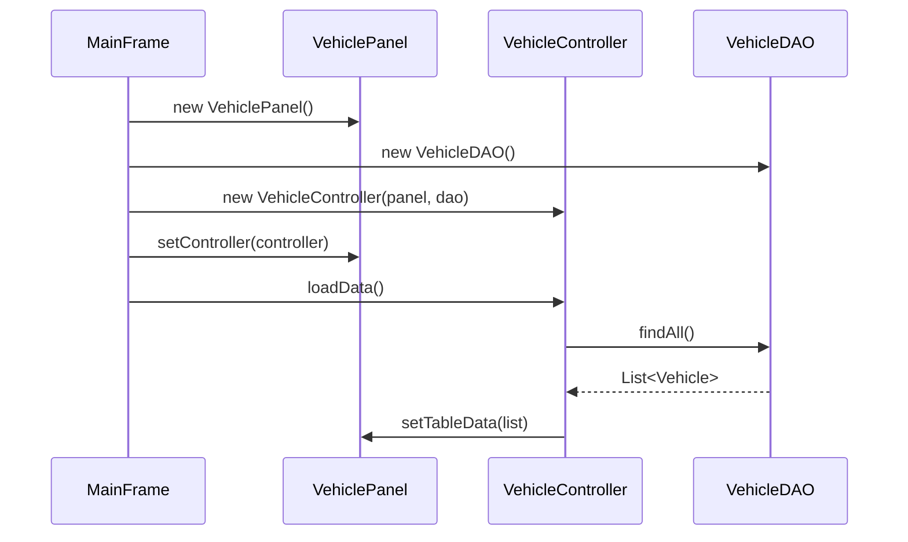

### 5.3 Login

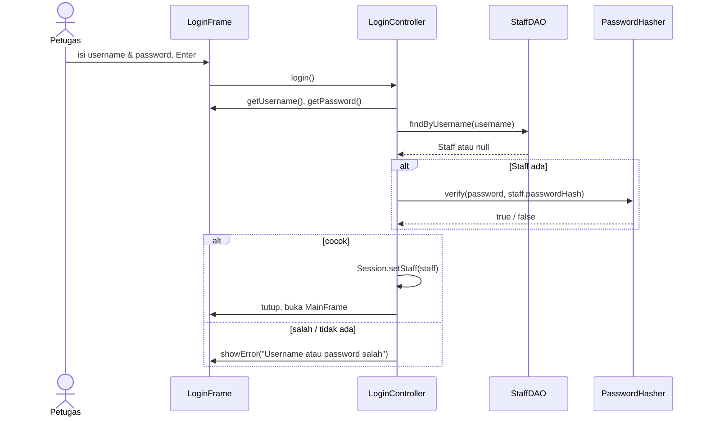
Pesan error **sama** untuk username tak dikenal dan password salah (tidak membocorkan keberadaan akun).

### 5.4 Menyimpan penyewaan (alur inti, atomik)

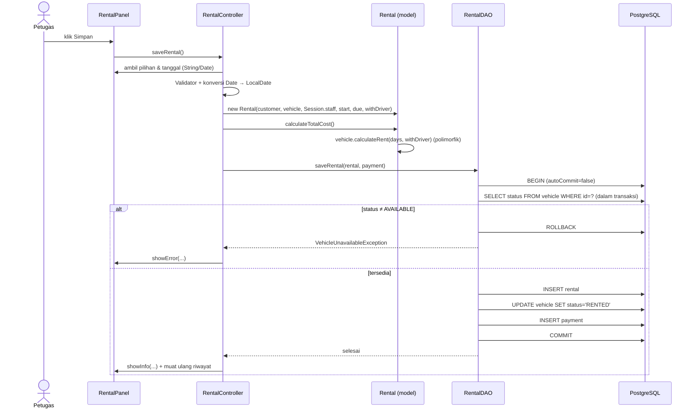
Semua langkah DB di dalam satu transaksi; kegagalan di tengah ⇒ `rollback` dan status kendaraan tidak berubah (PRD §7.4, skenario uji §17 no. 10).

### 5.5 Pengembalian & denda

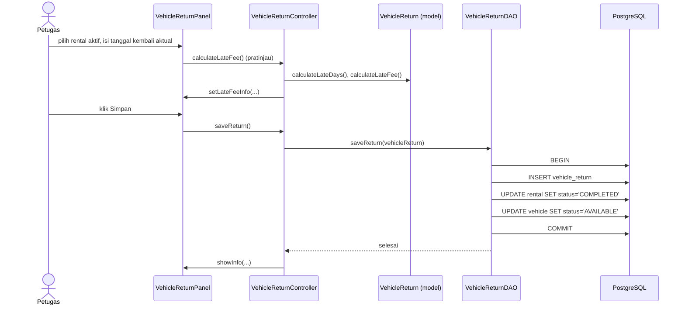

---

## 6. Model Data

### 6.1 ERD

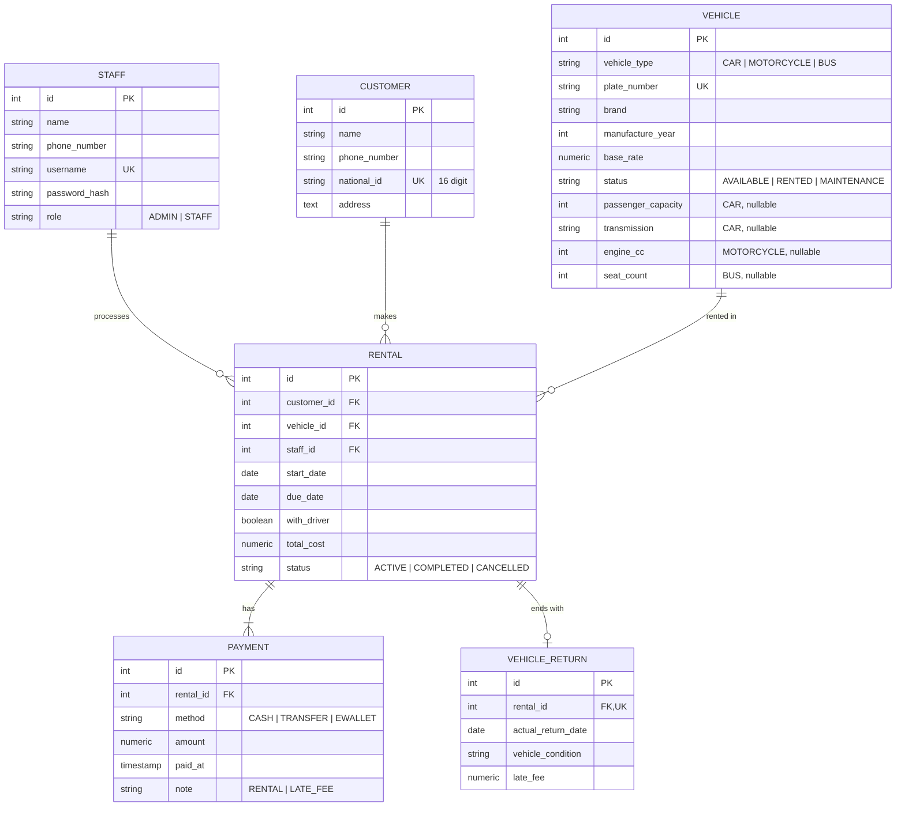
DDL lengkap dan constraint: `PRD.md` §8.

### 6.2 Pemetaan objek ↔ relasional

| Konsep OOP | Representasi DB | Catatan |
|---|---|---|
| Hierarki `Vehicle` (Car/Motorcycle/Bus) | **Satu tabel `vehicle`** (single-table inheritance), pembeda `vehicle_type`, kolom khusus subclass `NULL` bila tak relevan | Query sederhana, tanpa JOIN antar-subclass; harga: beberapa kolom nullable |
| `Customer`, `Staff` (turunan `Person`) | Tabel terpisah per kelas konkret; kolom `Person` diulang | `Person` abstrak tidak punya tabel sendiri |
| Enum | `VARCHAR` + `CHECK`, disimpan sebagai `enum.name()` | Menghindari tipe `ENUM` Postgres dan *cast* pada `PreparedStatement` |
| `LocalDate` / `LocalDateTime` | `DATE` / `TIMESTAMP` | Dibaca `rs.getObject(col, LocalDate.class)` |
| `double` uang | `NUMERIC(12,2)` / `NUMERIC(14,2)` | Sesuai contoh proposal; risiko pembulatan diterima untuk skala tugas |
| Asosiasi `Rental → Customer/Vehicle/Staff` | Foreign key; objek **diisi lengkap** saat membaca (JOIN/query lanjutan) | Struk & tabel riwayat tidak perlu menyentuh DB lagi |

---

## 7. Transaksi & Konsistensi

Satu koneksi bersama (`DatabaseConnection` Singleton); aplikasi dijalankan satu thread UI sehingga tidak ada konkurensi dalam proses. Konkurensi hanya muncul **antar-instans** (dua petugas pada saat bersamaan), ditangani lewat transaksi database.

| Operasi | Langkah dalam satu transaksi | Pelindung konsistensi |
|---|---|---|
| Simpan rental | `SELECT` status kendaraan → `INSERT rental` → `UPDATE vehicle → RENTED` → `INSERT payment` | Cek status **di dalam transaksi**; kegagalan ⇒ `rollback` |
| Batalkan rental | `UPDATE rental → CANCELLED` → `UPDATE vehicle → AVAILABLE` | Hanya dari `ACTIVE` |
| Simpan pengembalian | `INSERT vehicle_return` → `UPDATE rental → COMPLETED` → `UPDATE vehicle → AVAILABLE` | `UNIQUE(rental_id)` mencegah dua pengembalian |

Pola kode di `dao`: `setAutoCommit(false)` → kerja → `commit()`; `catch` → `rollback()`; `finally` → `setAutoCommit(true)` (selalu dipulihkan).

> **Batas yang diterima:** cek-lalu-ubah memakai `SELECT` biasa (bukan `SELECT ... FOR UPDATE`), sehingga dua instans yang bertransaksi *persis bersamaan* pada kendaraan yang sama secara teoretis dapat lolos keduanya. Untuk skala tugas ini diterima; peningkatannya cukup mengganti `SELECT` dengan `SELECT ... FOR UPDATE` atau `UPDATE vehicle SET status='RENTED' WHERE id=? AND status='AVAILABLE'` lalu memeriksa jumlah baris terpengaruh (cara kedua lebih disarankan bila ingin diperketat).

### 7.1 Mesin status

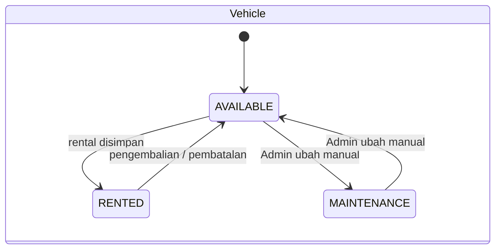

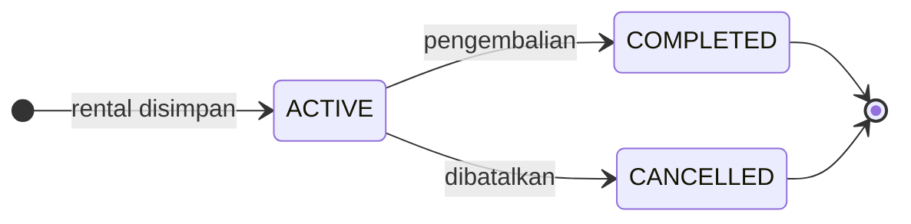
Hanya rental `ACTIVE` yang boleh diubah atau dibatalkan. Kendaraan `RENTED`/`MAINTENANCE` tidak boleh disewa (`VehicleUnavailableException`).

---

## 8. Penanganan Error

Prinsip: **tidak ada exception yang lolos ke Swing** dan pengguna tidak pernah melihat stack trace.

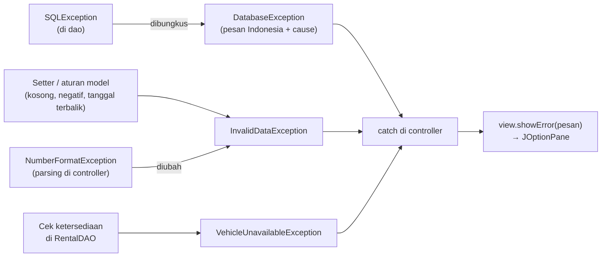

| Exception | Tipe | Sumber | Ditangani di | Hasil bagi pengguna |
|---|---|---|---|---|
| `InvalidDataException` | unchecked | `model` (setter), `Validator` | `controller` | Dialog yang menyebut **field** yang salah |
| `VehicleUnavailableException` | unchecked | `RentalDAO.saveRental` | `controller` | Dialog "Kendaraan tidak tersedia" |
| `DatabaseException` | unchecked | `dao`, `DatabaseConnection` | `controller` (dan `Main` saat start) | Dialog informatif; pelanggaran UNIQUE/FK diterjemahkan lewat SQLState (`23505` / `23503`) menjadi pesan ramah |

Alasan **unchecked** (`RuntimeException`): setter model melempar `InvalidDataException` tanpa mengotori setiap signature dengan `throws`, sesuai contoh kode di proposal. Konsekuensi: disiplin `try/catch` di `controller` wajib (itulah titik tangkap tunggal).

---

## 9. Konfigurasi, Keamanan, & Lingkungan

### 9.1 Konfigurasi & rahasia

| Hal | Cara | Aturan |
|---|---|---|
| Koneksi DB | `config/db.properties` (`db.url`, `db.user`, `db.password`) | **Tidak di-commit**; hanya `db.properties.example` |
| SSL ke Neon | `sslmode=require` di URL | Wajib |
| Timeout | `connectTimeout=15`, `socketTimeout=30` | Mengakomodasi *cold start* Neon |
| Akun awal | `StaffDAO.ensureDefaultAdmin()` (`admin/admin123`) bila tabel kosong | Ganti password setelah demo bila perlu |

### 9.2 Keamanan

| Ancaman | Mitigasi |
|---|---|
| SQL injection | Semua query `PreparedStatement`; dilarang menyambung string |
| Password bocor dari DB | Hanya `password_hash` (PBKDF2WithHmacSHA256, salt acak, ≥ 120.000 iterasi); password mentah `char[]` |
| Enumerasi akun | Pesan login seragam |
| Akses melebihi peran | Menu/tombol dibatasi oleh `Session.getStaff().isAdmin()` (lihat tabel hak akses `PRD.md` §7.5) |
| Kredensial DB di repo | `.gitignore` + panduan berbagi lewat kanal pribadi; **reset password Neon setelah pengumpulan** |

> **Batas yang diterima:** pembatasan peran hanya di sisi UI; siapa pun yang memegang kredensial database dapat mengakses data langsung. Cukup untuk tugas; bukan model keamanan produksi.

### 9.3 Build, jalankan, dan lingkungan

| Konteks | Output compile | Dijalankan lewat |
|---|---|---|
| Eclipse (manusia) | `bin/` | Run As → Java Application |
| Terminal (AI agent) | `build/classes` | `java -cp "build/classes:lib/*" rentgo.Main` (Windows memakai `;`) |

Keduanya di-`.gitignore`. Library manual di `lib/` dan didaftarkan di `.classpath`. Working directory harus root proyek agar `config/db.properties` terbaca.

### 9.4 Threading

Seluruh UI dan akses DB berjalan di **Event Dispatch Thread** (`SwingUtilities.invokeLater` pada start). Konsekuensinya UI dapat "membeku" sesaat saat koneksi pertama ke Neon (*cold start*) atau query lambat. Diterima untuk skala tugas; mitigasi bila perlu: `SwingWorker` untuk `loadData()` yang berat, dan dialog "Menghubungkan…" pada koneksi pertama.

---

## 10. Keputusan Arsitektur & Alternatif

| # | Keputusan | Alternatif yang dipertimbangkan | Alasan memilih |
|---|---|---|---|
| D1 | MVC + DAO tanpa framework | Spring / JPA / Hibernate | Tujuan tugas = menunjukkan OOP & arsitektur sendiri; tanpa magic |
| D2 | Proyek Eclipse biasa + `lib/` manual | Maven/Gradle | Dosen memakai Eclipse; mudah diimpor; dependensi hanya dua |
| D3 | PostgreSQL di Neon (bersama) | MySQL lokal per anggota | Data dapat dipakai bersama tim; tetap kompatibel dengan Postgres lokal untuk demo offline |
| D4 | Single-table inheritance untuk `Vehicle` | Table-per-class / joined | Sederhana; sesuai proposal; query tanpa JOIN |
| D5 | Enum sebagai `VARCHAR + CHECK` | Tipe `ENUM` Postgres | `setString` langsung bisa dipakai |
| D6 | `calculateRent(int, boolean)` konkret di `Vehicle` | Method hanya di `Car` + `instanceof` di `Rental` | Menghilangkan `instanceof`; polimorfisme tetap murni |
| D7 | View memegang controller (`setController`) | Controller memasang listener | Sesuai contoh proposal (`controller.tambahKendaraan()` di view) |
| D8 | Exception unchecked | Checked | Setter tetap ringkas; titik tangkap di controller |
| D9 | Satu koneksi Singleton | Connection pool | Aplikasi satu thread; pool tidak perlu |
| D10 | Hash PBKDF2 bawaan JDK | BCrypt (library) | Nol dependensi tambahan |
| D11 | Teks UI Indonesia, kode Inggris | Semua satu bahasa | Pengguna Indonesia; kode mudah dibaca & dicari |

---

## 11. Atribut Kualitas (Kebutuhan Nonfungsional)

| Kebutuhan (proposal §2.3.2) | Cara arsitektur memenuhinya |
|---|---|
| Data tersimpan permanen | PostgreSQL di Neon; transaksi atomik |
| Tampilan rapi saat jendela diubah | Layout manager (`GridBagLayout`, `BorderLayout`, `CardLayout`), tanpa layout `null`, `setMinimumSize` |
| Kode terorganisasi MVC & mudah dipelihara | Paket per lapisan, aturan dependensi §2.2, kontrak method di PRD |
| Kesalahan DB & input tidak menghentikan aplikasi | Hierarki exception §8, titik tangkap di controller, dialog informatif |
| (tambahan) Dapat diuji tanpa GUI | Aturan bisnis di `model` murni → `RentalCostTest` console; DAO → `DaoConsoleTest` |
| (tambahan) Kerja paralel 3 orang tanpa konflik | Kepemilikan per paket, kontrak signature, urutan Gate (`docs/DEV-GUIDE-*.md`) |

---

## 12. Risiko Arsitektur & Mitigasi

| Risiko | Dampak | Mitigasi |
|---|---|---|
| Neon *cold start* / internet putus saat demo | Aplikasi lambat/gagal terhubung | Retry satu kali + timeout ≥ 10 dtk; cadangan PostgreSQL lokal (ganti `db.url`); rekaman demo |
| Kredensial DB tersebar | Penyalahgunaan database | Tidak di repo; kanal pribadi; reset password setelah pengumpulan |
| Logika bisnis bocor ke view/controller | Melanggar penilaian MVC/OOP | Review PR memeriksa `* 0.9`, `1.5`, `150000` di luar `model`; aturan di PRD §0 |
| Perubahan kontrak diam-diam | Integrasi rusak antar anggota | Aturan "Mengubah Kontrak" di panduan; PR terpisah + persetujuan |
| Kondisi balapan antar-instans pada kendaraan yang sama | Dobel sewa (jarang) | Cek dalam transaksi; peningkatan opsional di §7 |
| Waktu sempit | Fitur tidak selesai | Prioritas P0/P1/P2 (PRD §2); potong P1/P2, bukan pengujian |

---

## 13. Titik Perluasan

| Ingin menambah | Perubahan yang dibutuhkan |
|---|---|
| Jenis kendaraan baru (mis. Van) | Subclass `Vehicle` + nilai `VehicleType` + kolom khusus (bila perlu) + satu cabang di factory `VehicleDAO` + opsi di `VehiclePanel`; `Rental`, controller, laporan **tidak berubah** |
| Metode pembayaran baru | Nilai `PaymentMethod` + `CHECK` di `payment.method` |
| Aturan tarif baru (mis. diskon akhir pekan) | Hanya di method `calculateRent` subclass terkait |
| Ganti media penyimpanan (SQLite / berkas) | Implementasi baru untuk setiap `CrudDAO`; model, controller, view tidak berubah |
| Putus siklus view ↔ controller | Interface view per modul (§2.2 catatan) |
| UI tidak membeku | `SwingWorker` pada `load*()` |

---

## 14. Jejak ke Dokumen Lain

| Topik | Rujukan |
|---|---|
| Kontrak method, atribut, validasi per kelas | `PRD.md` §6, §9, §10, §11, §12 |
| Aturan tarif, denda, status, hak akses | `PRD.md` §7 |
| DDL | `PRD.md` §8 |
| Struktur folder Eclipse, build terminal | `PRD.md` §4 |
| Keputusan & asumsi | `PRD.md` §15 |
| Skenario uji | `PRD.md` §17 |
| Urutan kerja, Gate, jadwal per anggota | `docs/DEV-GUIDE-1-MODEL-DB.md`, `docs/DEV-GUIDE-2-DAO-CONTROLLER.md`, `docs/DEV-GUIDE-3-VIEW.md` |
